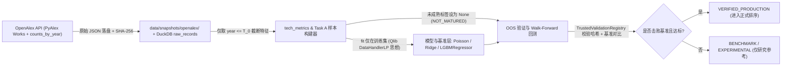

# Foresight Alpha V1.2 — 最小可行版本详细方案 (`V1.2_MVP_DESIGN.md`)

> **定位**：用最少开发投入打通“真实 OpenAlex 历史快照 → 无前视特征构建 → 简单基准对照 & LightGBM → `TrustedValidationRegistry` 样本外校验 → Walk-Forward 回测”的 V1.2 最小闭环（对应路线图第一、三阶段核心）。  
> **严格边界**：本方案聚焦 **Task A（技术科研成长预测）**；在阶段四真实财报与行情接口就位前，Task B/C 保持 `UNVERIFIABLE`，绝不虚构结果。

---

## 一、端到端数据流与模块关系

### 核心模块职责划分
1. **采集与快照层（`src/ingestion/openalex.py`）**：
   - 使用 `pyalex.Works` 按年度与 `Topics` / 关键词分页拉取真实文献、摘要与机构列表；
   - 按 `counts_by_year` 中 `year <= T_0` 聚合截至截断年的历史引用；按去重 `institution.id` 统计真实活跃机构数；
   - 每次采集将完整响应写入 `data/snapshots/openalex/<topic_id>_<year>.json` 并计算文件真实字节 SHA-256，写入 `raw_records`。
2. **特征与标签构造层（`src/ingestion/tech_dataset.py` 扩展）**：
   - **特征（均严格满足 `published_at <= T_0`）**：
     - `papers_velocity_1y`：$\frac{N(T_0) - N(T_0 - 1)}{\max(N(T_0 - 1), 1)}$
     - `papers_acceleration`：一阶增量变化率
     - `active_institutions`：去重机构数
     - `cit_velocity_pit`：基于 `counts_by_year <= T_0` 计算的当年新增引用增速
     - `institution_entropy`：基于 `src/tech_discovery/clustering.py:calculate_shannon_entropy` 计算的真实机构分布熵（替换 `pipeline.py:247` 启发式公式）
     - `github_momentum`：历史截面统一置 `None`（不回填实时 Star）
   - **真实预测目标（Task A，参考 PreScience）**：
     - `target_1y` / `target_3y` / `target_5y`：$\log\left(1 + \frac{N(T_0 + H)}{N(T_0)}\right)$（或直接倍数 $N(T_0 + H) / N(T_0)$，评估同步计算 `log_mae` 与 `spearman`）；
     - 若 $T_0 + H > T_{\text{now}}$ 或稳定期未到，严格设 `target = None`、`status = NOT_MATURED`。
3. **模型与简单基准层（`src/diffusion/baseline.py` & `lgbm_forecaster.py`）**：
   - **简单基准（必跑）**：
     1. 历史动量外推（Momentum Extrapolation）；
     2. Ridge 线性回归（仅在训练集 `fit` 标准化器，测试集只读 `transform`）；
     3. Poisson / 负二项计数基准（对非负文献增长建模）。
   - **LightGBM（保留现有治理框架）**：独立按 1y/3y/5y 成熟样本训练，仅当样本量充足且通过交叉验证调参后与基准同台对比。
4. **验证与双轨输出层（`model_validator.py` + `opportunity_pool.py`）**：
   - 修复 `opportunity_pool.py:149-154` 遗漏 `is_verified` 的 Bug；
   - `TrustedValidationRegistry` 根据快照文件实际 SHA-256 注册真实验证集；
   - `PointInTimeBacktestEngine` 按截断日 $T_k \in \{2018\text{-}12\text{-}31, 2019\text{-}12\text{-}31, 2020\text{-}12\text{-}31\}$ 滚动训练并核算 `log_mae`、`spearman` 与 `Precision@K`（对比简单基准超额胜率）。

---

## 二、最小可行测试设计（遵循 `AGENTS.md`）

| 测试类别 | 测试文件与用例 | 验证要点（正向 + 反向防御） |
| :--- | :--- | :--- |
| **PIT 引用防泄露** | `tests/test_openalex_pit.py` | 1. Mock OpenAlex 响应含 `cited_by_count=2528` 与 `counts_by_year={2020: 107, 2021: 450...}`，断言 `cutoff=2020-12-31` 仅提取 `107`； 2. 断言 `institution_count` 等于去重机构 ID 数而非 `*12` 估算； 3. 断言快照文件真实字节 SHA-256 与 `raw_records.raw_hash` 完全一致 |
| **GitHub 历史禁用** | `tests/test_openalex_pit.py` | 断言历史样本生成时 `github_momentum` 为 `None`，且 `github.py` 数据被标记 `NOT_ELIGIBLE_FOR_STRICT_BACKTEST` |
| **成熟度与处理器隔离** | `tests/test_v12_task_a_pipeline.py` | 1. 构造 `2023-12-31` 样本，断言 `target_1y` 已成熟而 `target_5y` 严格为 `None`（`NOT_MATURED`）； 2. 验证训练集标准化器参数不被验证集数据污染（`DataHandlerLP` 原则） |
| **基准对比与晋升门禁** | `tests/test_v12_task_a_pipeline.py` | 1. 运行 Ridge/Poisson vs LightGBM 对比，输出 `log_mae` 与 `spearman`； 2. 反向测试：人为让 LightGBM 误差劣于基准时，断言其状态保持 `BENCHMARK` 而非 `VERIFIED_PRODUCTION` |
| **契约回归** | `tests/test_opportunity_pool_verified_flag.py` | 构造已验证 `LightGBMGrowthForecaster`，断言 `OpportunityPoolManager` 正确传递 `is_lgbm_verified=True`（修复 `L149-154` 断链） |
| **CI 离线隔离** | `tests/test_offline_e2e.py` & `scripts/run_ci_checks.sh` | **全部 CI 测试继续 100% 离线运行**（通过已落盘规范化快照与 Mock），不依赖公网稳定性 |

---

## 三、V1.2 第一项最值得立即编码的任务

综合本轮全部源码审计与开源对标，**V1.2 第一项真正值得编码的任务**是：

> **任务名称**：`V1.2 Step 1 — 基于 PyAlex 改造 OpenAlexCollector 并修复 opportunity_pool.py 的 is_verified 断链`  
> **理由**：  
> 1. 它是全系统唯一能立即合法获取真实历史时序（2013–2025）且成本最低的数据入口；  
> 2. 当前 `openalex.py:55` 正在向库里写入含未来引用的失真数据，不修好数据源，后续任何主题发现、特征工程、LightGBM 与回测都是“垃圾进、垃圾出”；  
> 3. 修复 `opportunity_pool.py:149-154` 的 `is_verified` 传递断链仅需数行改动，可立刻打通模型验证成功后的正式输出通路。
